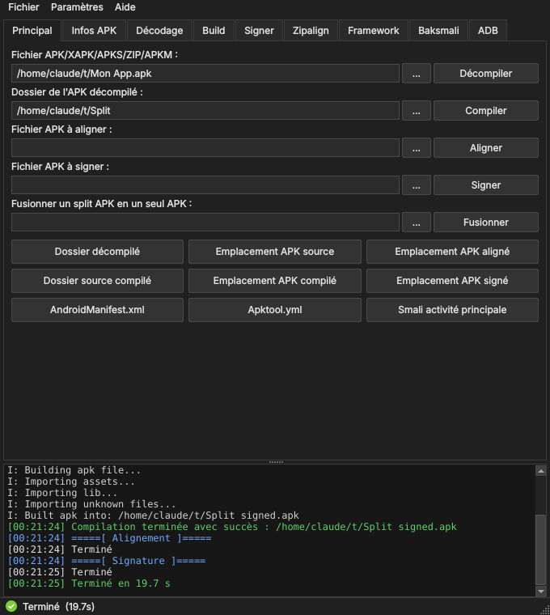

# APK Tool GUI Linux

[English](README.md) | [Français](README.fr.md) | **Español** | [Русский](README.ru.md)

[](https://github.com/rerem8433/apktoolgui-linux/releases/latest)
[](https://github.com/rerem8433/apktoolgui-linux/releases)


Fork nativo para Linux (Python 3 + PyQt6) de [APKToolGUI](https://github.com/AndnixSH/APKToolGUI) 3.4.0.0 de AndnixSH.
Port para Linux: **ParadoxXx Squad**.



## Funciones
- Descompilar / compilar con **Apktool 3.0.3** o **APKEditor 1.4.9** (los proyectos APKEditor se detectan automáticamente)
- Fusión de XAPK / APKS / APKM / ZIP en un único APK (APKEditor), descompilación directa de split APK
- Firma con **apksigner** (clave pem/pk8 o keystore JKS, esquemas v1→v4), **zipalign** (`-p`, Zopfli, verificación)
- Cadena compilar → zipalign → firmar → instalar por ADB
- APK sin firmar con la firma original (Core Patch)
- Correcciones automáticas de Apktool (manifest, `sparseResources`, `APKTOOL_DUMMY`)
- Smali / Baksmali, instalación y limpieza de frameworks
- Info APK (aapt2): icono, versiones, SDK, ABI, idiomas, permisos, volcado completo, certificado
- Pestaña ADB: dispositivos, conexión Wi-Fi `IP:puerto`, instalación (`-i com.android.vending`, `--abi`)
- Arrastrar y soltar en todas partes, registro en colores, tema oscuro/claro
- Interfaz en **inglés, francés, español y ruso** (idioma del sistema por defecto, configurable en *Ajustes*)
- **Menú contextual de Nemo** (Linux Mint): descompilar, compilar una carpeta, firmar, alinear, fusionar, info, baksmali, instalar
- Línea de comandos: `apktoolgui-linux --decompile app.apk` (`--compile`, `--sign`, `--align`, `--merge`, `--info`, `--baksmali`, `--install`)

## Instalación (Linux Mint 21/22, Ubuntu 22.04+)
Descarga el `.deb` desde las [Releases](https://github.com/rerem8433/apktoolgui-linux/releases/latest) y luego:
```
sudo apt install ./apktoolgui-linux_1.0.2_amd64.deb
```
Dependencias instaladas automáticamente: `python3-pyqt6`, `python3-pyqt6.qtsvg`, `qt6-image-formats-plugins`, Java (`default-jre-headless`), `zipalign`, `adb`.
Recomendado: `qt6-translations-l10n` (diálogos estándar de Qt traducidos).
Opcional: *Ajustes → Herramientas* descarga los últimos platform-tools / build-tools oficiales de Google en `~/.local/share/apktoolgui-linux/sdk`.

## Archivos
- Ajustes: `~/.config/apktoolgui-linux/config.json`
- Frameworks: `~/.local/share/apktoolgui-linux/framework`
- Temporales: `~/.cache/apktoolgui-linux/tmp`

## Ejecutar desde el código fuente
```
sudo apt install python3-pyqt6 python3-pyqt6.qtsvg default-jre-headless zipalign adb
cd src && python3 -m apktoolgui
```
Construir el .deb: `packaging/build-deb.sh`

## Changelog
Ver [CHANGELOG.es.md](CHANGELOG.es.md).

## Problemas
[Abrir una issue](https://github.com/rerem8433/apktoolgui-linux/issues)

## Créditos
APKToolGUI (AndnixSH, dominio público) · Apktool (iBotPeaches) · APKEditor (REAndroid) · smali/baksmali (JesusFreke / Google) · apksigner, zipalign, adb, aapt2 (AOSP).
