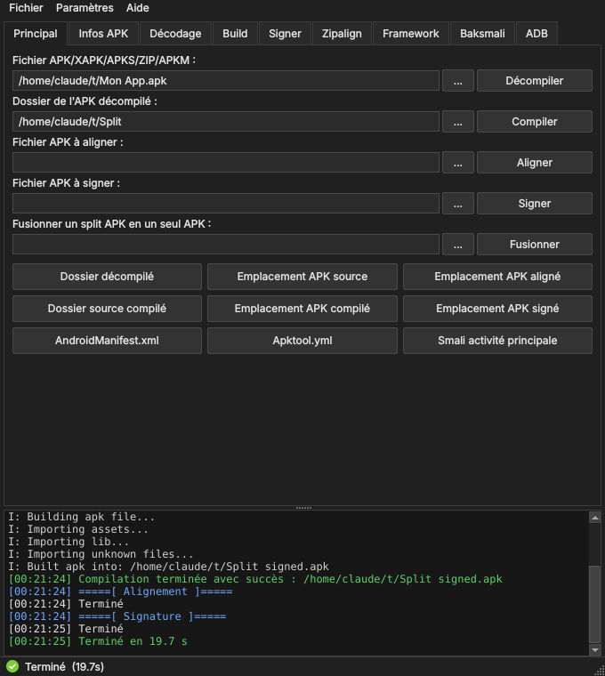

# APK Tool GUI Linux

**English** | [Français](README.fr.md) | [Español](README.es.md) | [Русский](README.ru.md)

[](https://github.com/rerem8433/apktoolgui-linux/releases/latest)
[](https://github.com/rerem8433/apktoolgui-linux/releases)


Native Linux fork (Python 3 + PyQt6) of [APKToolGUI](https://github.com/AndnixSH/APKToolGUI) 3.4.0.0 by AndnixSH.
Linux port: **ParadoxXx Squad**.



## Features
- Decompile / compile with **Apktool 3.0.3** or **APKEditor 1.4.9** (APKEditor projects are detected automatically)
- Merge XAPK / APKS / APKM / ZIP into a single APK (APKEditor), decompile split APKs directly
- Sign with **apksigner** (pem/pk8 key or JKS keystore, schemes v1→v4), **zipalign** (`-p`, Zopfli, check only)
- One-click chain: compile → zipalign → sign → install over ADB
- Unsigned APK with the original signature (Core Patch)
- Automatic Apktool fixes (manifest, `sparseResources`, `APKTOOL_DUMMY`)
- Smali / Baksmali, framework install and cleanup
- APK info (aapt2): icon, versions, SDK, ABIs, locales, permissions, full dump, certificate
- ADB tab: devices, Wi-Fi connection `IP:port`, install (`-i com.android.vending`, `--abi`)
- Drag & drop everywhere, colored log, dark/light theme
- Interface in **English, French, Spanish and Russian** (system language by default, selectable in *Settings*)
- **Nemo right-click menu** (Linux Mint): decompile, compile a folder, sign, align, merge, info, baksmali, install
- Command line: `apktoolgui-linux --decompile app.apk` (`--compile`, `--sign`, `--align`, `--merge`, `--info`, `--baksmali`, `--install`)

## Installation (Linux Mint 21/22, Ubuntu 22.04+)
Download the `.deb` from the [Releases](https://github.com/rerem8433/apktoolgui-linux/releases/latest), then:
```
sudo apt install ./apktoolgui-linux_1.0.2_amd64.deb
```
Dependencies installed automatically: `python3-pyqt6`, `python3-pyqt6.qtsvg`, `qt6-image-formats-plugins`, Java (`default-jre-headless`), `zipalign`, `adb`.
Recommended: `qt6-translations-l10n` (translated standard Qt dialogs).
Optional: *Settings → Tools* downloads the latest official Google platform-tools / build-tools to `~/.local/share/apktoolgui-linux/sdk`.

## Files
- Settings: `~/.config/apktoolgui-linux/config.json`
- Frameworks: `~/.local/share/apktoolgui-linux/framework`
- Temporary files: `~/.cache/apktoolgui-linux/tmp`

## Run from source
```
sudo apt install python3-pyqt6 python3-pyqt6.qtsvg default-jre-headless zipalign adb
cd src && python3 -m apktoolgui
```
Build the .deb: `packaging/build-deb.sh`

## Changelog
See [CHANGELOG.md](CHANGELOG.md).

## Issues
[Open an issue](https://github.com/rerem8433/apktoolgui-linux/issues)

## Credits
APKToolGUI (AndnixSH, public domain) · Apktool (iBotPeaches) · APKEditor (REAndroid) · smali/baksmali (JesusFreke / Google) · apksigner, zipalign, adb, aapt2 (AOSP).
