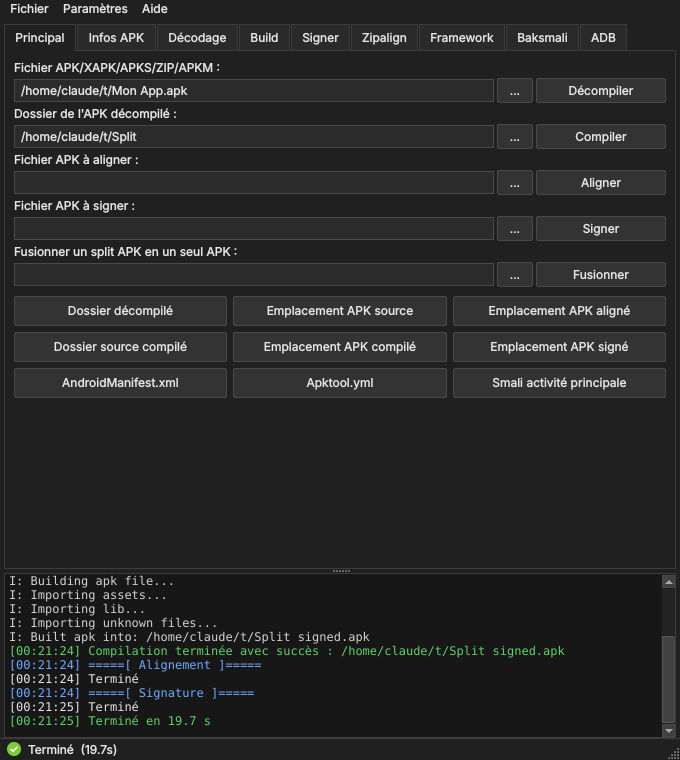

# APK Tool GUI Linux

[English](README.md) | [Français](README.fr.md) | [Español](README.es.md) | **Русский**

[](https://github.com/rerem8433/apktoolgui-linux/releases/latest)
[](https://github.com/rerem8433/apktoolgui-linux/releases)


Нативный Linux-форк (Python 3 + PyQt6) программы [APKToolGUI](https://github.com/AndnixSH/APKToolGUI) 3.4.0.0 от AndnixSH.
Портирование на Linux: **ParadoxXx Squad**.



## Возможности
- Декомпиляция / сборка с помощью **Apktool 3.0.3** или **APKEditor 1.4.9** (проекты APKEditor определяются автоматически)
- Слияние XAPK / APKS / APKM / ZIP в один APK (APKEditor), прямая декомпиляция split APK
- Подпись через **apksigner** (ключ pem/pk8 или keystore JKS, схемы v1→v4), **zipalign** (`-p`, Zopfli, проверка)
- Цепочка: сборка → zipalign → подпись → установка через ADB
- Неподписанный APK с оригинальной подписью (Core Patch)
- Автоматическое исправление ошибок Apktool (manifest, `sparseResources`, `APKTOOL_DUMMY`)
- Smali / Baksmali, установка и очистка фреймворков
- Информация об APK (aapt2): значок, версии, SDK, ABI, языки, разрешения, полный дамп, сертификат
- Вкладка ADB: устройства, подключение по Wi-Fi `IP:порт`, установка (`-i com.android.vending`, `--abi`)
- Drag & drop везде, цветной журнал, тёмная/светлая тема
- Интерфейс на **английском, французском, испанском и русском** (по умолчанию язык системы, выбор в *Настройках*)
- **Контекстное меню Nemo** (Linux Mint): декомпиляция, сборка папки, подпись, выравнивание, слияние, инфо, baksmali, установка
- Командная строка: `apktoolgui-linux --decompile app.apk` (`--compile`, `--sign`, `--align`, `--merge`, `--info`, `--baksmali`, `--install`)

## Установка (Linux Mint 21/22, Ubuntu 22.04+)
Скачайте `.deb` в разделе [Releases](https://github.com/rerem8433/apktoolgui-linux/releases/latest), затем:
```
sudo apt install ./apktoolgui-linux_1.0.2_amd64.deb
```
Зависимости устанавливаются автоматически: `python3-pyqt6`, `python3-pyqt6.qtsvg`, `qt6-image-formats-plugins`, Java (`default-jre-headless`), `zipalign`, `adb`.
Рекомендуется: `qt6-translations-l10n` (перевод стандартных диалогов Qt).
Необязательно: *Настройки → Инструменты* загружает последние официальные platform-tools / build-tools от Google в `~/.local/share/apktoolgui-linux/sdk`.

## Файлы
- Настройки: `~/.config/apktoolgui-linux/config.json`
- Фреймворки: `~/.local/share/apktoolgui-linux/framework`
- Временные файлы: `~/.cache/apktoolgui-linux/tmp`

## Запуск из исходников
```
sudo apt install python3-pyqt6 python3-pyqt6.qtsvg default-jre-headless zipalign adb
cd src && python3 -m apktoolgui
```
Сборка .deb: `packaging/build-deb.sh`

## Список изменений
См. [CHANGELOG.ru.md](CHANGELOG.ru.md).

## Проблемы
[Открыть issue](https://github.com/rerem8433/apktoolgui-linux/issues)

## Благодарности
APKToolGUI (AndnixSH, общественное достояние) · Apktool (iBotPeaches) · APKEditor (REAndroid) · smali/baksmali (JesusFreke / Google) · apksigner, zipalign, adb, aapt2 (AOSP).
